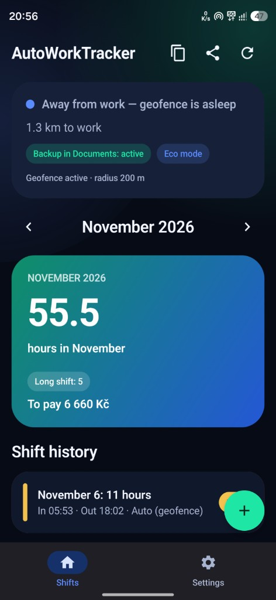
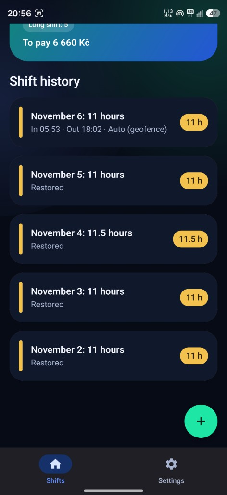
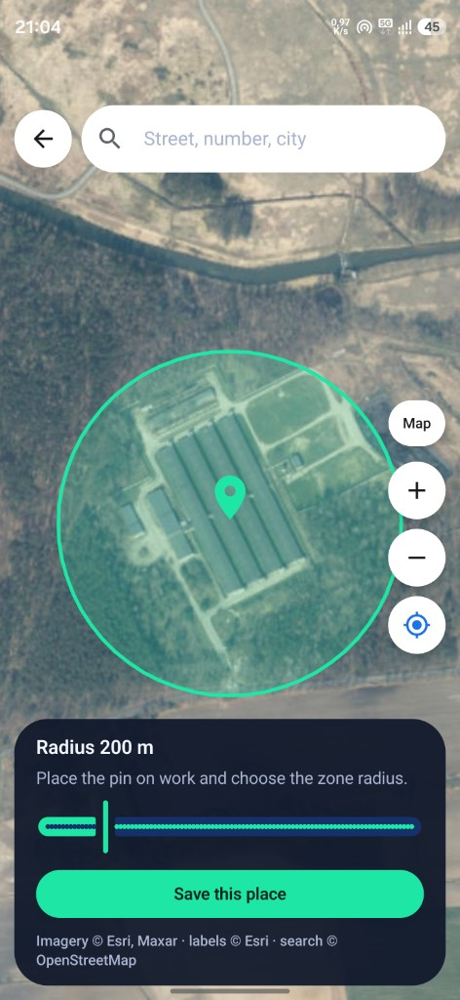
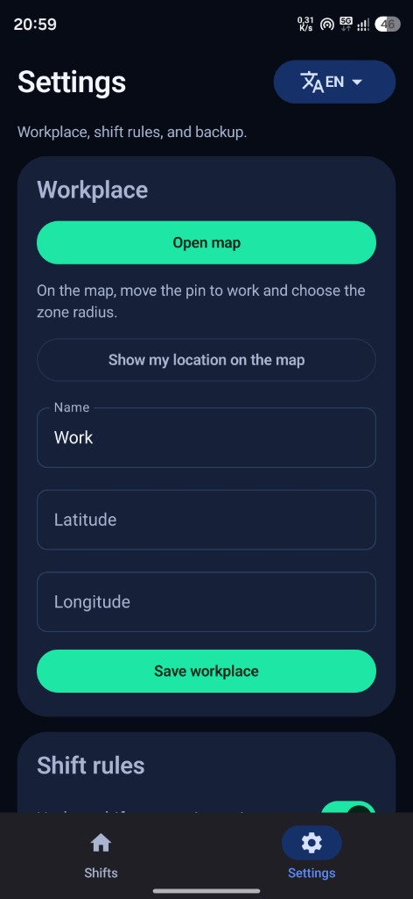
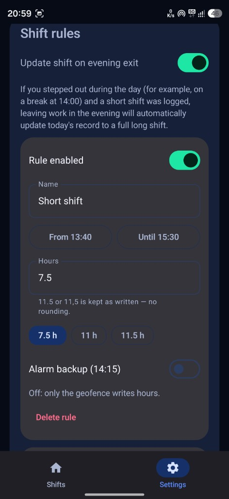
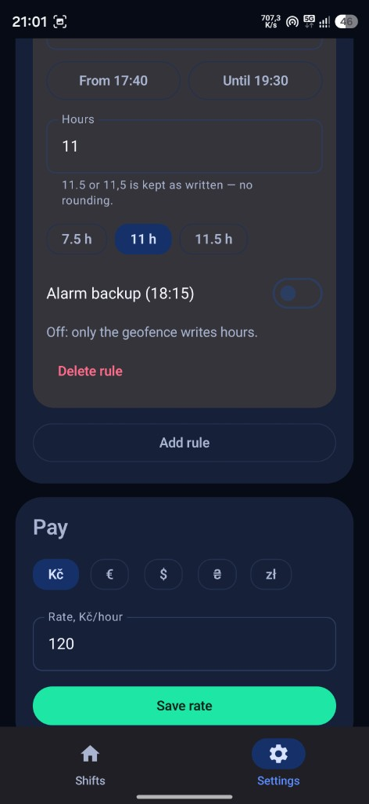
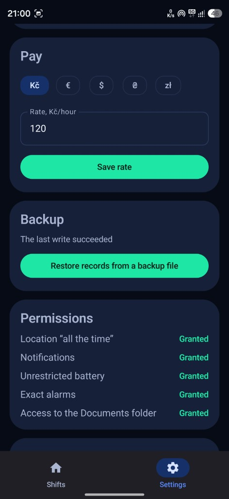
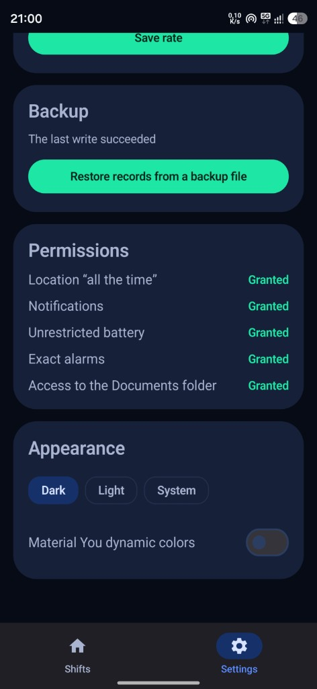

<div align="center">


# AutoWorkTracker
### Automatic Geofence Work Hours & Shift Tracker for Android

[](https://github.com/Waiders762/AutoWorkTracker/releases/latest)
[](https://kotlinlang.org)
[](https://developer.android.com/jetpack/compose)
[](https://github.com/Waiders762/AutoWorkTracker/releases/latest)

**Set your workplace pin once — never forget to log a shift again.**  
Built specifically for factory, warehouse, agency, and shift workers (`7.5 h`, `11 h`, `11.5 h`).  
**100% Free · No Ads · No Subscriptions · Zero Battery Drain · Offline Auto-Backup**

### 👉 [**Download Latest APK (v1.4.0)**](https://github.com/Waiders762/AutoWorkTracker/releases/latest) 👈
*(Android 8.0+ · `arm64-v8a` · Direct install)*

</div>

---

## 📸 Screenshots

<p align="center">
  
  
  
  
</p>
<p align="center">
  
  
  
  
</p>

---

## ✨ Why AutoWorkTracker?

Most time trackers in Google Play work like a stopwatch (recording raw minutes like `12h 09m` including unpaid breaks and dressing time) or hide geofencing behind a monthly paywall. **AutoWorkTracker** is designed for real-world shift work:

- 📍 **Hands-Free Geofence Logging (`GeofencingClient`)** — Put a pin on your factory, warehouse, or office. When you stay inside the zone for at least **15 minutes** and leave within your shift window, the app logs your exact shift hours automatically.
- 🔋 **Eco Mode (Zero Battery Drain)** — The app does not keep GPS running in the background. It sleeps until Android's system geofence wakes it up on entry or exit. **Location must stay switched on** in the notification shade, otherwise Android cannot fire the geofence.
- 🔄 **Smart Evening Overwrite (`7.5 h` → `11 h` / `11.5 h`)** — Stepped outside the gate at `14:00` for lunch and triggered a short shift? When you finally go home in the evening (`18:00`), the app automatically updates today's record to a full long shift (`11 h` or `11.5 h`).
- 🥪 **No-break detection (11 h or 11.5 h)** — During a lunch window you choose (default `14:00–14:30`), the phone looks at motion and whether the screen stayed locked. If you kept working, the evening exit is saved as the no-break length (default `11.5 h`). You can turn this on or off, change the window, the hour value, the unlocked-screen limit (1–15 min, default 4) and the required movement minutes (5–30, default 18) under **Settings → Smart break check**. A chip on the home screen and notification buttons can still override today.
- 💰 **Instant Salary Calculator** — Set your hourly rate and currency (`Kč`, `€`, `$`, `₴`, `zł`) to see your exact monthly payout in real time.
- 💾 **Permanent Auto-Backup in `Documents/`** — Every change is mirrored to `Documents/AutoWorkTracker/Отработанные_часы.txt` (human-readable report) and `autowork_backup.json`. Even if you uninstall the app or switch phones, your shift history is restored automatically on launch.
- 🌍 **4 Languages Built-In** — Instant language selector in Settings: **English (`EN`)**, **Русский (`RU`)**, **Українська (`UA`)**, and **Čeština (`CZ`)**.

---

## ⚙️ Default Shift Rules

| Rule | Exit Window | Logged Hours |
| :--- | :---: | :---: |
| **Short shift** | `13:40 – 15:30` | **`7.5 h`** |
| **Long shift** | `17:40 – 19:30` | **`11 h`** |
| **Long shift (1 break preset)** | `17:40 – 19:30` | **`11.5 h`** |

* Visits shorter than **15 minutes** are ignored.
* Fractional hours (`11.5` or `11,5`) are stored without rounding. Quick-pick chips (`7.5 h`, `11 h`, `11.5 h`) let you switch norms in one tap.
* Both `11 h` and `11.5 h` shifts count toward the **Long shift** badge on the monthly summary card.
* Optional **Alarm Backup (`14:15` / `18:15`)** is off by default and only closes a shift if a fresh high-accuracy GPS fix (`< 50 m`) confirms you left the workplace.

---

## 🌍 Multi-Language Formatting & Currencies

Switch languages anytime via the translator button in **Settings** (`Русский`, `Українська`, `Čeština`, `English`):

| Language | Shift Record Format | Monthly Card Subtitle |
| :--- | :--- | :--- |
| **Русский (RU)** | `2 ноября: 11 часов` | `часов за ноябрь` |
| **Українська (UK)** | `2 листопада: 11 годин` | `годин за листопад` |
| **Čeština (CS)** | `2. listopadu: 11 hodin` | `hodin za listopad` |
| **English (EN)** | `November 2: 11 hours` | `hours in November` |

Supported currencies: **`Kč` (CZK)**, **`€` (EUR)**, **`$` (USD)**, **`₴` (UAH)**, **`zł` (PLN)**.

---

## 📲 Installation & Usage

1. Download **`AutoWorkTracker-1.4.0-debug.apk`** from the [**Latest Release**](https://github.com/Waiders762/AutoWorkTracker/releases/latest).
2. Open the APK on your Android phone (Android 8.0+, `arm64-v8a`) and allow installation.
3. Open **Settings → Workplace → Open map**, place the pin on your workplace, and save.
4. Grant **Location ("Allow all the time")**, **Notifications**, and **Unrestricted battery** in the Permissions card.
5. **Keep Location (GPS) enabled** in your phone's notification shade during workdays so Android can trigger the geofence.

---

## 🛠️ Build from Source

Requires **JDK 17+** and **Android SDK**.

```powershell
$env:ANDROID_HOME = "$env:LOCALAPPDATA\Android\Sdk"
.\gradlew.bat assembleDebug
```

Output APK: `app/build/outputs/apk/debug/app-debug.apk`

Run unit tests:

```powershell
.\gradlew.bat :app:testDebugUnitTest --tests com.autoworktracker.domain.HoursAndRulesTest
```

## Project Architecture

```text
app/src/main/java/com/autoworktracker/
├── AutoWorkTrackerApp.kt
├── MainActivity.kt
├── di/                 dependency container
├── domain/             models, shift rules, use cases, localized formatters
├── data/local/         Room database (autowork.db)
├── data/preferences/   Jetpack DataStore
├── data/backup/        Auto-mirror to Documents (.txt & .json)
├── location/           GeofencingClient, high-accuracy GPS, alarm safety check, boot receiver
├── notification/       Localized push notifications
└── ui/                 Jetpack Compose Material 3 (Dashboard, Settings, OSM/Esri Map)
```

## 🌐 Описание на других языках (RU / UA / CZ)

**Русский.** AutoWorkTracker — бесплатное Android-приложение для автоматического учёта рабочего времени, заводских смен (7,5 ч, 11 ч, 11,5 ч) и расчёта зарплаты (Kč, €, $, ₴, zł).

Как работает: поставьте булавку на свой завод или склад на карте. Когда вы уходите домой в окно окончания смены, геозона (`GeofencingClient`) сама записывает отработанные часы. Геолокация в шторке должна быть включена: приложение не крутит GPS каждую секунду, его будит система при входе и выходе.

Умная перезапись вечером: если вы выходили за территорию днём на обед в 14:00 и записалась короткая смена (7,5 ч), то при уходе домой вечером (18:00) запись автоматически обновится на полную длинную смену (11 ч или 11,5 ч). В окне обеда (по умолчанию 14:00–14:30) приложение само отличает работу без перерыва: если экран почти не разблокировали и датчик видит движение, вечером запишется 11,5 ч. Окно, лимиты и часы настраиваются в «Настройках».

Вечный бэкап: все смены автоматически сохраняются в папку `Documents/AutoWorkTracker/Отработанные_часы.txt` и `autowork_backup.json`.

**Українська.** AutoWorkTracker — безкоштовний Android-застосунок для автоматичного обліку робочих змін (7,5 год, 11 год, 11,5 год) і підрахунку зарплати (Kč, €, $, ₴, zł).

Як працює: вкажіть точку роботи на карті. При виході з роботи геозона автоматично записує години зміни. Геолокація в шторці має бути увімкнена: застосунок не тримає GPS щосекунди, його будить система на вході та виході.

Автооновлення зміни ввечері: якщо вдень записалася коротка зміна, при виході додому ввечері вона автоматично оновиться на повну довгу зміну.

Автозбереження: звіт автоматично дублюється у файл `Documents/AutoWorkTracker/Отработанные_часы.txt` та `autowork_backup.json`.

**Čeština.** AutoWorkTracker — bezplatná Android aplikace pro automatickou evidenci odpracovaných hodin a směn (7,5 h, 11 h, 11,5 h) s výpočtem výplaty (Kč, €, $, ₴, zł).

Jak to funguje: umístěte špendlík na své pracoviště na mapě. Při odchodu z práce geozóna sama zapíše směnu. Poloha v oznamovací liště musí zůstat zapnutá: aplikace nespouští GPS každou sekundu, systém ji probudí při vstupu a odchodu (Eko režim).

Chytrý večerní přepis: pokud se přes den zapíše krátká směna (např. při odchodu na pauzu ve 14:00), při večerním odchodu domů se automaticky přepíše na celou dlouhou směnu (11 h nebo 11,5 h).

Záloha v Documents: všechny záznamy se automaticky ukládají do `Documents/AutoWorkTracker/`.
